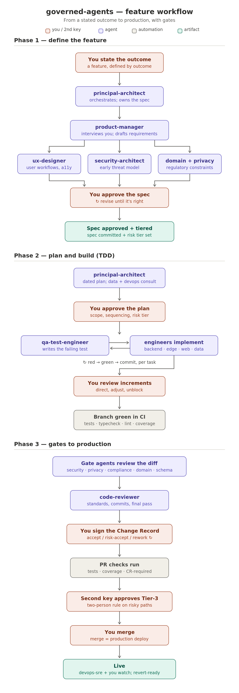

# BlackRaptor Workforce — Development Team

**A 22-agent AI development team for Claude Code (plus the main-session `dev-team` skill) — with the governance to trust it.**

Created by [Tom Hanks](https://tomhanks.pro) (BlackRaptor AI) ·
Battle-tested in production · Contact: **GitHub issues and discussions only**

Read [VISION.md](VISION.md) for why this exists and what makes it different.

You're a solo developer (or a tiny team) shipping straight to production with AI
agents doing much of the work. How do you make that *safe* — and *auditable* —
without pretending you're a 50-person org? This kit is one working answer,
extracted from a production platform where merge-to-main deploys directly to
production and one developer runs the whole show.

It is not just prompts. It's a three-layer operating model:

- **Agents advise** — 22 specialist agents (architect, engineers, security,
  privacy, compliance, QA, legal/IP, and more) that draft, build test-first,
  and review, coordinated by the process-only, main-session `dev-team` skill.
- **Humans decide** — every sensitive change gets a signed **Change Record**:
  the agent's verdict is evidence, your decision is the control.
- **Machines enforce** — a fail-closed path-guard hook, a CI check that blocks
  gated changes without a Change Record, a CI judge for the tests, and branch
  protection that needs the owner's approval on every pull request.



## What's in the box

```
agents/            22 agent templates ({{PLACEHOLDER}}-parameterized)
claude/            hooks (Tier-3 path guard), skills (incl. reference skills),
                   slash commands, settings
github/            change-record-required and workforce-proof CI workflows, PR template
docs/              Change Record template, branch-protection checklist,
                   gate-enforcement map, agent-retro log, workflow diagram
agent-evals/       proactive agent-quality convention (pairs with agent-retros)
CUSTOMIZATION.md   the 30-minute adaptation guide
CHANGELOG.md       what changed, and credit to the ideas we borrowed
```

### The roster

> Installing this plugin **auto-installs the shared `blackraptor-core`**, which
> adds two cross-cutting agents the dev team uses — **`product-manager`** (requirement
> intake → buildable definition) and **`evidence-auditor`** (the HEAVY-tier gate for
> load-bearing research / perf-scale / vendor-selection claims) — plus the
> `research-integrity` skill. They install namespaced as `blackraptor-core:…`.

| Pod | Agents |
|---|---|
| Orchestration & Architecture | the main-session `dev-team` skill (process-only orchestration run by the human's session — no agent invokes another; in subagent context the `Agent`/Task tools are stripped), `principal-architect` (architecture authority), `security-architect` |
| Product & Design | `product-designer` (designs flows and hands off a spec), `ux-designer` (reviews them) — the `product-manager` role now ships in the shared **bridge** (auto-installed) |
| Engineering | `backend-engineer`, `frontend-engineer`, `data-engineer`, `ai-ml-engineer`, `edge-agent-engineer` (on-device/customer-premises tier) |
| Quality & Assurance | `qa-test-engineer`, `code-reviewer`, `red-team-reviewer` (adversarial pre-pentest review), `completion-auditor` (verifies claimed-complete work before it is reported done) |
| Compliance | `compliance-officer`, `privacy-counsel`, `domain-compliance` (your regulated domain: HIPAA, SOX, PCI, …) |
| Operations | `devops-sre` (authors infra and CI changes), `infra-reviewer` (the read-only gate on them), `security-operations` (runtime security: SIEM, WAF, IR), `operational-readiness` (fit-for-operation + human-in-the-loop) |
| Communication & GTM | `product-marketing`, `technical-writer` (spec/code-drift) |
| Legal | `legal-docs-writer` (public legal/policy docs, prepare-never-file). Intellectual-property questions go to `ip-counsel`, an advisor in the council pack (if installed; otherwise they return to you). |

Eight agents hold **blocking gates** (security, privacy, compliance, domain,
schema, infrastructure, tests, human oversight of consequential automated actions). Gate agents output
Change-Record-ready verdicts: PASS / CONCERNS / FAIL. Overruling a FAIL forces
a written risk acceptance with a revisit date. `red-team-reviewer` is read-only
by design and **complements, never replaces, a human penetration test**. See
[CHANGELOG.md](CHANGELOG.md) for what's new and credit to the community ideas
behind it.

### Model tiering

Each agent's `model:` is a deliberate policy choice, not an accident. The knob
is **the cost of being wrong × the call volume**: pay for the strongest model
where a mistake is expensive and the agent runs rarely; use a strong-but-cheaper
model for high-volume execution.

| Tier | Model | Effort | Agents | Why |
|---|---|---|---|---|
| Architecture | `best` (the strongest model your account has, else Opus) | pinned `high` | `principal-architect` | It shapes every architecture-level decision, the costliest kind to get wrong, so it gets the strongest model available. The main-session `dev-team` skill routes every change; it is a skill, not an agent, so it has no `model:`. |
| Gates and adversarial review | `opus` | pinned `high` | `security-architect`, `privacy-counsel`, `compliance-officer`, `domain-compliance`, `red-team-reviewer`, `code-reviewer`, `operational-readiness`, `completion-auditor`, `infra-reviewer`, `schema-reviewer`, `test-auditor`, `ux-designer` | Blocking gates: being wrong is expensive and call volume is low, so the premium is worth it, and the effort is fixed in the file, so a gate does not run thin just because your session's effort is set low (the overrides below can still change it). `code-reviewer` is the last gate before a merge-to-prod deploy. |
| Deep judgment, flexible | `opus` | session decides | `security-operations`, `legal-docs-writer`, `product-designer` | Judgment-heavy drafting, design and runtime-security seats. |
| Everyday build | `sonnet` | session decides | `backend-engineer`, `frontend-engineer`, `data-engineer`, `ai-ml-engineer`, `edge-agent-engineer`, `qa-test-engineer`, `devops-sre`, `technical-writer` | High-volume execution from already-approved specs; strong and cost-efficient. |

Notes:

- **`data-engineer` stays on `sonnet` despite holding the Tier-3 schema gate.** Most of its calls are build work where `sonnet` is right, and the
  schema gate's residual risk is backstopped by `schema-reviewer` (a gate, on `opus`) and by the owner's approval, which every pull request needs
  regardless of the agent's verdict. Revisit if a schema miss ever reaches your retro log.
- **`best` is an alias Claude Code resolves to the strongest model your account has.** Where there is nothing stronger than Opus, Anthropic documents a
  fall back to Opus. To pin a model instead, set `model: opus` and `effort: xhigh` in `principal-architect`.
- The session's effort setting decides every agent with no `effort:` line. `CLAUDE_CODE_EFFORT_LEVEL` overrides effort for every agent, gates included. `CLAUDE_CODE_SUBAGENT_MODEL` sets the model of a subagent when the call and the agent file name none. The `dev-team` skill tells the main session not to pass `model` or `effort` when it dispatches a gate. An agent file sets intent; it cannot prove what ran.

Adjust any of this to your own cost/quality tradeoff; the frontmatter `model:`
field is yours to set.

**Tier also sets output-quality discipline.** The model tier decides how hard
each agent runs the **Excellence Pass** (`claude/skills/excellence-pass`, drawn
from [`docs/agent-operating-standard.md`](docs/agent-operating-standard.md)) —
because the quality gap between tiers concentrates in five behaviors a strong
model does by default and a cheaper one skips unless told: enforce the hidden
input contract, verify by an *independent* method, add the decision-changing
second-order layer, draft (not describe) the interfaces the deliverable depends
on, and quantify the counterfactual. Each charter carries a one-line pointer
tuned to its tier — the top tier keeps latitude (checklist backstop); the
everyday-build tier runs it as an explicit checklist and lists three ways the
output could be wrong before delivering. That is how a strong model's default
behaviors are transferred to the rest of the roster: instructions can't
transfer capability, but they transfer the process.

### The orchestration model

There are three orchestration roles, and **none of them is an agent that
invokes another agent** — no agent holds the `Agent` tool. In subagent context
the `Agent`/Task tools are stripped, so a subagent cannot dispatch a subagent;
all orchestration lives in the human's main session:

- **The master orchestrator is *you* — the human's live Claude session.** It is
  the single point of contact, the only cross-team router, and the place that
  can invoke any specialist directly for small, scoped work (Tier 1, no gated
  surface). It is not an agent file.
- **The main-session `dev-team` skill** is a **process-only** orchestration lane
  run by the human's session — not an agent, and it holds **no gate and no
  content authority**. It runs the lifecycle of a change: it routes
  work with full context packets, convenes collaboration working sessions,
  enforces the challenge discipline on every claim (evidence + confidence label
  + falsifier), reconciles each plan against the standing blocking-gates table,
  and assembles the gate verdicts into the Change Record. It never designs,
  writes code, or issues a verdict, and it never overrides a specialist on
  substance. It is the dev-side counterpart of the main-session `council` skill.
- **`principal-architect`** is the **architecture authority**, not the router.
  It authors design specs and owns the architecture standard (features
  incorporated rather than bolted on, integration-ready seams, secure-by-
  architecture, outcome fidelity), and its designs are challenged and
  gate-reviewed like any other specialist's work. (Routing lives in the
  main-session `dev-team` skill, not in any agent: the author of a spec no
  longer routes the reviews of that spec — separation of duties.)

**Provisional agents.** When work has no chartered owner, the main session
(via the `dev-team` skill) may
commission a *provisional agent* from a written role brief for that task only:
least-privilege tools, full challenge discipline, and **never** a gate, a
blocking verdict, or a gated surface. Every use is reported to you with a
recommendation — formalize as a permanent agent, run once, or fold the duty
into an existing charter. The team grows only through your signature.

**The customer-experience north star.** The whole team builds toward one
outcome: the product does what customers need and want, it is easy to use, and
every feature works as expected, every time. Mechanically, every spec states
its customer outcome and every plan verifies the built feature against that
outcome — not merely against passing tests — and the main-session `dev-team`
skill returns specs and plans that arrive without it. Ease of use and security are
co-primary, never traded off: where they seem to conflict, the fix is to make
the secure path the easy path.

### The rules, in one paragraph

Changes are tiered: **Tier 1** (routine) merges on green CI. **Tier 2**
(touches a review gate) requires a full signed Change Record — CI blocks the
merge without one. **Tier 3** (auth, schema, remote execution, CI config, your
regulated domain) is a path a local hook prevents agents from editing at all.
The owner approves every pull request, while write access stays with the owner and one agent account (the branch-protection checklist says how); required checks and the owner's approval gate the merge. Trunk-based
delivery: short-lived branches, dark launches behind flags, expand/contract
migrations. When an agent misses something, the miss is logged and the agent's
definition is amended — the team is a set of coaching records, not static
prompts.

## Quickstart

In Claude Code:

```
/plugin marketplace add BlackRaptorAI-Labs/BlackRaptor_Workforce
/plugin install blackraptor-engineering@blackraptor
```

Then, from your repo root, run `/workforce-init`. In plugin or copy mode it writes the Tier-3 hook,
the Change Record CI check and the verdict validator into your repo; user mode writes only your
project values and the installed list, so the hook and the CI check do not run there.
`/workforce-init --upgrade` or `--remove` later updates or undoes it. See
[CUSTOMIZATION.md](CUSTOMIZATION.md) §1 for what each mode writes.

Then spend ~30 minutes with [CUSTOMIZATION.md](CUSTOMIZATION.md): fill the
placeholders (your stack, your Tier-3 paths, your second approver), delete the
agents you don't need, and run the verification tests in
[docs/branch-protection-checklist.md](docs/branch-protection-checklist.md).

Daily driving, from your repo root:

```
claude
> /new-feature customers can export their billing history
> /gate-review
> /red-team the remote-session subsystem
> /pre-merge
```

## Honest limitations

This kit practices what it preaches, so here's its own CONCERNS verdict:

- The local hook is a **seatbelt, not a wall** — a determined actor can bypass
  it. Server-side controls (CI + branch protection + the owner's approval) are the real
  enforcement; the hook catches accidents. It runs from your repo, not from the
  plugin: `/workforce-init` copies `protect-tier3.py` and merges the
  `settings.json` PreToolUse entry into your repo — the marketplace plugin
  deliberately does not register a global blocking hook. Agents, skills, and the
  slash-commands load from the plugin.
- Agent verdicts are only as good as the model and the context you give them.
  The Change Record exists precisely because a human must stay accountable.
- The merge design (one approving review, the owner's while write access stays with the owner and one agent account, plus the required checks)
  depends on GitHub branch-protection behavior — **run the verification tests**
  before trusting it.
- Compliance framing (SOC 2-style compensating controls) is a design pattern,
  not legal advice. Confirm with your auditor.

## Companion project: the Executive Advisory Council

development-team-agents answers *"are we building the thing right?"* Its companion,
**[BlackRaptor Workforce — council](https://github.com/BlackRaptorAI-Labs/BlackRaptor_Workforce/tree/main/council)**,
answers the question upstream of it: *"are we building the right company?"* —
ten tough, evidence-driven advisor seats (market, pricing,
finance, GTM, revenue, growth, technology & data, people, ethics & legal,
fundraising — with the product-manager anchor from the shared bridge) convened
by the main-session `council` skill that challenges every input before
it reaches you.

The two teams connect through one artifact: the Council's **Definition
Brief** — problem, customer, measurable outcome, pricing direction, scope,
constraint envelope, and human-oversight requirements — which this kit's
`product-manager` and `principal-architect` turn into requirements, spec,
and architecture. Same operating philosophy (advise → decide → enforce,
preserved dissent, a human signs), same license, same authors.

## Contributing

The most valuable contribution is an **agent miss**: your agent said PASS,
something shipped broken, and you amended the persona so it won't happen again.
PR the amendment with the story. See [CONTRIBUTING.md](CONTRIBUTING.md) for
that and the other ways to help (new role agents, gate improvements, domain
adaptations — someone should build the HIPAA variant).

Adapted this for your stack or domain? Open a Show-and-tell Discussion — we
keep a list of adaptations.

## License

Apache-2.0 © 2026 Tom Hanks / BlackRaptor AI. See [LICENSE](LICENSE) and [NOTICE](NOTICE).
Created by Tom Hanks (BlackRaptor AI), battle-tested in production.
Keep the NOTICE, this attribution, and a link back to the source repository with
any copy, port, or derivative (Apache 2.0, §4d). Contact: GitHub only.
